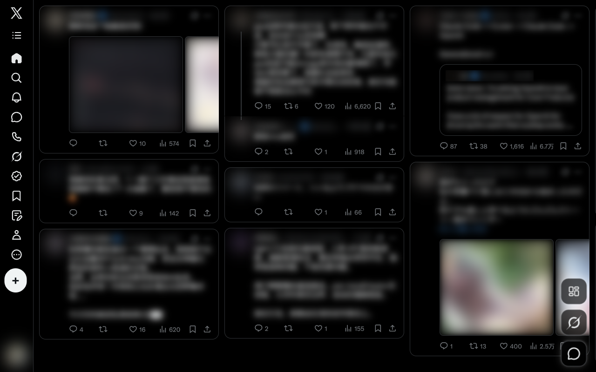
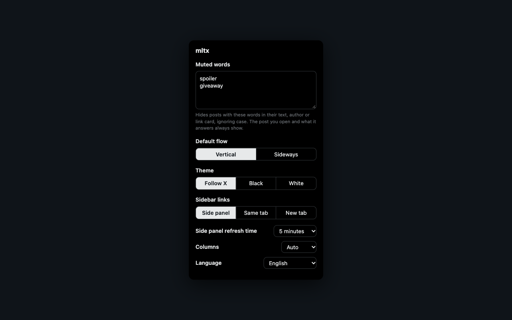

# mltx

A browser extension that lays out the x.com home timeline (For you, Following and pinned
lists) as a multi-column masonry that fills the window. Every other page stays as X
renders it.



## Install

- **Chrome**: [Chrome Web Store](https://chromewebstore.google.com/detail/cbbnhkbpnkddoofhjpkpdklllikbigfj)
- **Safari 18.4+ (macOS 14+)**: download `mltx-<version>-safari.dmg` from
  [Releases](https://github.com/dreaifekks/mltx/releases/latest). It is signed and
  notarized. Drag mltx into Applications and open it once, then turn it on in Safari's
  Settings, under Extensions, and allow it on x.com.
- **Firefox 128+**: the Firefox zip on Releases is not signed by Mozilla, so it only loads
  as a temporary add-on from `about:debugging`, which Firefox removes when it restarts.

## Use

Open [x.com/home](https://x.com/home) in a window at least 900px wide. Narrower windows
keep X's own layout.

### Layout

- The column count follows the window: as many columns as fit at 360px or wider, up to 4.
- `Alt+-` and `Alt+=` set the column count by hand, and `Alt+0` goes back to automatic
  (`Alt` is `Option` on a Mac). This is the same setting as the column count in the
  toolbar popup.
- The button above X's Grok and chat buttons switches to a sideways flow: screen-high
  columns that scroll left and right. A sideways swipe stays native, a vertical gesture
  or mouse wheel anywhere in the window moves the list, and a card taller than its
  column scrolls inside itself. The switch lasts until the page reloads; set the default
  flow in the toolbar popup.

### Sidebar and side panels

- To switch timelines (For you, Following, pinned lists), hover the list icon under the
  X logo.
- Hover the X logo and click to expand or collapse the sidebar. X only draws labels
  in windows about 1265px or wider, so narrower ones keep the plain logo.
- The sidebar's links open in a side panel over the feed. Clicking outside the panel
  returns to the feed, and clicking the same icon again brings the page back as you
  left it.

### Post window

- Clicking a post opens X's post page in a floating window: the conversation on the left,
  with the action bar and reply box pinned below it, and the sort button and replies on
  the right. Click outside it or press Esc to close it. The window stays loaded in the
  background, so only the first open loads a page. Photos, profile links and buttons on a
  card keep doing what they do.
- The left side shows the conversation from its first post down to the one you clicked,
  scrolled just far enough to show that post in full. Everything above it is shown in
  full, and you can scroll up to it. Clicking any post, above or among the replies, moves
  the window to it the same way.
- Quoted posts, "show this thread" links and timestamps on a card open in the post window
  too, and so do posts clicked in a side panel, over that panel. A click on a photo in a
  quoted post is left to X.
- While a side panel or the post window is open, the browser's back and forward buttons
  move through its pages. Going back past its first page closes it.

### Settings

- The toolbar icon opens the settings: muted words, default flow, theme (follow X, black
  or white), where the sidebar's links open (side panel, same tab or new tab), the side
  panel's refresh time, the column count, and the language. A page left hidden longer
  than the refresh time loads again when reopened, in the post window too.
- Everything saves as it changes and reaches open pages at once, except that changing the
  theme reloads them, since X only reads the theme when it starts.
- The settings and the hints on the extension's buttons come in Chinese, English and
  Japanese. They follow the browser's languages until one is chosen, and fall back to
  English. X's own text stays in the language set on X.



### Feed

- Muted words hide posts in the feed, the post window's replies and the side panels, by
  their text, author or link card. The post you open and what it answers always show.
- The post box is removed from the timeline. The sidebar's + button opens the composer.
- Ads, Who to follow, trends and X's other non-post modules are removed from the feed.
  A conversation's "show more replies" row stays inside its card and opens the post window.

## Privacy

No servers, accounts, analytics or ads; settings stay in your browser. See
[PRIVACY.md](PRIVACY.md) for what mltx reads, stores and changes.

mltx is an independent project, not affiliated with or endorsed by X Corp.

## Limitations

- mltx depends on the internals of X's web app. If a change at X keeps the timeline from
  attaching within 8 seconds, or makes the layout fail 3 times in a row, the page falls
  back to X's own layout.
- The side panel keeps its 3 most recently used pages alive and the post window keeps one.
  Each is a full X page in an iframe, so they cost memory.

## Build from source

```sh
npm ci
npm test         # end-to-end against a fake x.com; needs `npx playwright-core install chromium`
npm run build    # dist/chrome, dist/firefox, dist/safari
```

To try a build in Chrome, turn on Developer mode in `chrome://extensions`, click Load
unpacked and pick `dist/chrome`, or the repository folder itself. Packaging and releases
are in [docs/RELEASING.md](docs/RELEASING.md), and how the layout drives X's list is in
[docs/ARCHITECTURE.md](docs/ARCHITECTURE.md).

## License

[MIT](LICENSE)

The approach of driving X's list through a proxy viewport comes from
[x-ultrawide](https://github.com/thehasnaink/x-ultrawide) (MIT). No code is copied.
